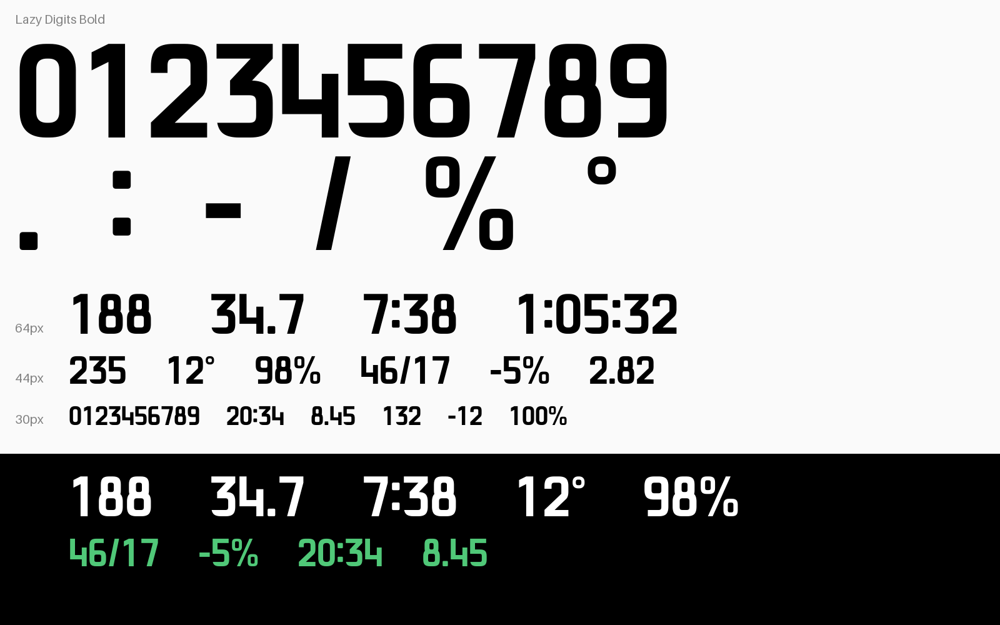

# Lazy Digits

자전거 속도계, 스포츠 시계, 대시보드처럼 **작은 화면을 흘끗 보고 읽는** 곳을 위한 좁고 굵은 숫자 글꼴입니다.
숫자와 몇 가지 기호만 들어 있고, SIL Open Font License로 자유롭게 쓸 수 있습니다.

[English](README.md)



## 만든 이유

가민 Edge 데이터필드 [Lazy Dashboard](https://apps.garmin.com/apps/6b6fd786-e6ac-4419-9f56-75a55b97b7a3)를 위해
만들었습니다. 라이딩 정보를 한 화면에 모으다 보니 전용 숫자 글꼴이 필요했습니다.

- **같은 칸에 더 큰 숫자:** 숫자 폭이 높이의 0.60이라 대부분의 화면용 글꼴보다 좁습니다. 세 자리 파워 값을 같은
  칸에 넣으면 가민 Roboto보다 숫자가 약 10% 커집니다.
- **언어와 상관없이 같은 숫자:** 본체 언어를 한국어(및 다른 아시아 언어)로 둔 Edge는 시스템 숫자 글꼴이 훨씬 작은
  비트맵으로 바뀝니다. 앱에 넣은 글꼴은 본체 언어와 상관없이 같은 크기로 나옵니다.

## 디자인

- 둥근 사각형 곡선, 일정한 획 굵기, 가로획은 세로획보다 조금 얇게(시각 보정)
- 작거나 흐려도 서로 구별되는 모양: 평평한 윗부분의 3, 열린 4, 곧은 꼬리의 6·9, 둥근 0, 가파른 7, 짧고 완만한
  깃발의 1
- **모든 숫자의 폭이 같음:** 타이머·속도·파워처럼 계속 바뀌는 값이 좌우로 흔들리지 않습니다.
- 시계·타이머 표시를 위해 콜론은 숫자 높이 가운데에 둡니다.

## 글자

`0 1 2 3 4 5 6 7 8 9` `.` `:` `-`(U+2212 마이너스 포함) `/` `%` `°`, 공백

## 사용법

**PC:** `fonts/ttf/LazyDigits-Bold.ttf`를 설치하면 됩니다.

**가민 Connect IQ:** 앱에는 TTF를 넣을 수 없고 BMFont 형식의 비트맵 글꼴만 넣을 수 있습니다.
`tools/make_bmfont.py`로 크기별로 만듭니다.

```sh
python tools/make_bmfont.py fonts/ttf/LazyDigits-Bold.ttf 48 resources/fonts/lazy48
```

```xml
<fonts>
    <font id="Lazy48" filename="lazy48.fnt" antialias="true"/>
</fonts>
```

글자는 검은 바탕에 회색으로 담습니다. `antialias="true"`일 때 가장자리가 부드럽게 나오는 형식은 이것뿐이었습니다
(투명도 채널에 담으면 흑백 1비트로 컴파일됨). 글자 상자를 숫자 높이에 딱 맞춰서, `Graphics.TEXT_JUSTIFY_VCENTER`가
숫자 자체를 가운데에 놓습니다. 글자 17개, 48 px 크기의 부드러운 글꼴은 Edge 530에서 앱 메모리를 약 3 KB, Edge
1040에서는 거의 쓰지 않았습니다.

## 소스에서 만들기

윤곽은 프로그램으로 만듭니다. `sources/build_font.py`가 둥근 사각형, 막대, 사선을 조합하고
[skia-pathops](https://github.com/fonttools/skia-pathops)로 합친 뒤 [fontTools](https://github.com/fonttools/fonttools)로
TTF를 씁니다. 디자인 선택(3 모양, 폭, 굵기 등)은 파일 위쪽의 설정값입니다.

```sh
pip install -r requirements.txt
python sources/build_font.py fonts/ttf
python tools/specimen.py
```

## 라이선스

Copyright 2026 Lazy Farmer. [SIL Open Font License 1.1](OFL.txt)로 배포합니다. 상업적 용도를 포함해 자유롭게 쓰고,
앱에 넣고, 고치고, 다시 배포할 수 있습니다. 글꼴 자체만 따로 판매하는 것은 안 됩니다.
